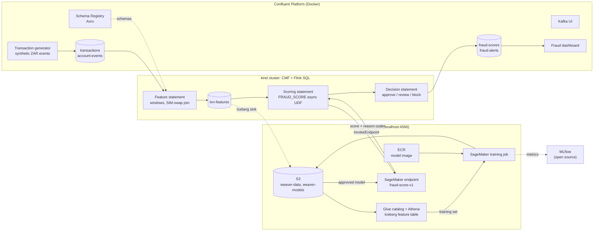
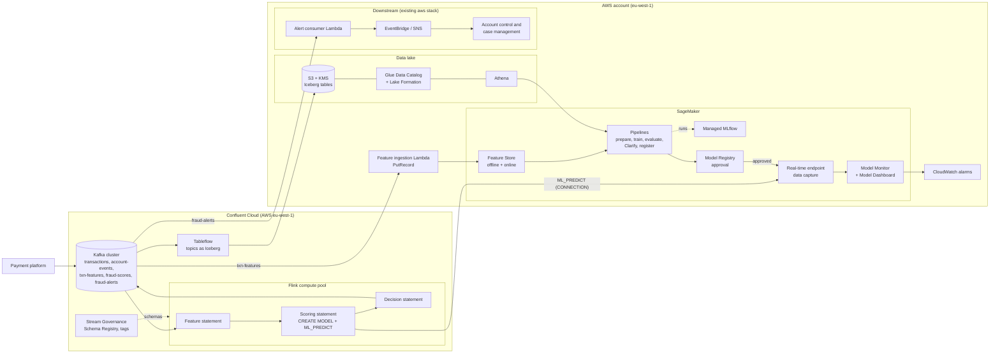

# Weaver

**Real-time ML decisioning on Kafka events.** Weaver is a shared platform that turns a stream of customer events into model-driven decisions within about a second: Flink computes features from Kafka, a SageMaker model scores each event, and the decision is published back to Kafka for downstream systems to act on.

The first use case is **real-time fraud scoring** for a South African fintech. Further use cases (mule detection, credit take-up, next-best offer, collections and others) plug into the same platform as new folders, not new stacks.

> **Status:** proof of concept. Runs fully offline on a laptop: Confluent Platform for Kafka and Flink, and [Floci](https://floci.io/floci/) for AWS. The same Terraform targets Confluent Cloud and a real AWS account in `npr` and `prod`.

## Build status

| Phase | Scope | Status |
| --- | --- | --- |
| Week 1: Foundations | Repo, tooling, local runtime (Floci, Kafka, Schema Registry, Kafka UI, kind + CMF), Floci state backend, health checks, kind network smoke test | **In this repo** |
| Week 2: Streaming | Topics and Avro schemas, transaction generator, feature statement | Planned |
| Week 3: Model | Training data, XGBoost image, training job, endpoint, MLflow | Planned |
| Week 4: Inference | `FRAUD_SCORE` UDF, scoring and decision statements, load test | Planned |
| Week 5: Harden and demo | Model v2 rollout, dashboard, runbook | Planned |

---

## Contents

- [Build status](#build-status)
- [How it works](#how-it-works)
- [Architecture: local POC](#architecture-local-poc)
- [Architecture: AWS and Confluent Cloud](#architecture-aws-and-confluent-cloud)
- [What changes between environments](#what-changes-between-environments)
- [Repository layout](#repository-layout)
- [Getting started](#getting-started)
- [Tasks](#tasks)
- [Terraform conventions](#terraform-conventions)
- [SageMaker: target design vs POC](#sagemaker-target-design-vs-poc)
- [Floci support baseline](#floci-support-baseline)
- [Use cases](#use-cases)
- [Testing](#testing)
- [Key decisions](#key-decisions)
- [Open questions](#open-questions)

---

## How it works

Every payment follows the same path: **event → features → score → decision**.

1. The payment system processes a payment and publishes an event to the `transactions` topic.
2. A Flink statement updates the customer's running features: payment velocity over 1 and 24 hours, amount against the 30-day average, new beneficiary, new device, SIM swap in the last 72 hours, night-time, distinct provinces.
3. A Flink scoring statement sends the feature vector to the SageMaker endpoint and gets back a fraud probability and the top three reason codes.
4. A decision statement applies the thresholds and writes the result to `fraud-scores`, and alerts to `fraud-alerts`.

| Score | Decision | Action |
| --- | --- | --- |
| Below 0.50 | Approve | Nothing |
| 0.50 to 0.85 | Review | Alert on `fraud-alerts` for an analyst; account stays open |
| 0.85 and above | Block | Alert and request an account hold, so further payments are refused |

Thresholds are starting values, to be tuned on the validation set.

**Scoring runs beside the payment, not in front of it.** Payments are never held waiting for a score, so a slow or failed model can never delay a customer. The payment that triggers a decision has already gone through; a **Block** stops what follows by asking the payment platform to hold the account. If the endpoint fails, the event is written with decision **Review** and reason `model_unavailable`, so a failure never auto-approves.

### Example: account takeover

| Time (SAST) | Event | Score | Decision |
| --- | --- | --- | --- |
| 01:52 | SIM swap on the customer's number | — | — |
| 01:58 | Login from a new device | — | — |
| 02:03 | PayShap R4,800 to a beneficiary added a minute earlier | 0.71 | Review, alert raised |
| 02:05 | Second transfer, R4,900, same beneficiary | 0.88 | Block, account hold requested |
| 02:06–02:09 | Four more attempts | — | Refused by the payment system (account on hold) |

---

## Architecture: local POC

Three local runtimes on one Docker network (`weaver`), all provisioned by Terraform. No AWS or Confluent Cloud account is needed.



| Layer | Local implementation | UI |
| --- | --- | --- |
| Kafka and Schema Registry | Confluent Platform broker (KRaft) and Schema Registry containers | Kafka UI, `localhost:9021` (swap for Control Center if licensed) |
| Stream processing | Confluent Manager for Apache Flink (CMF) on a kind cluster; Flink SQL statements; Java async UDF | CMF UI and Flink Web UI (port-forward) |
| AWS | Floci: S3, Glue, Athena, ECR, IAM, Secrets Manager, CloudWatch Logs, SageMaker training and hosting | Floci console, `localhost:4566/_floci/ui` |
| Experiment tracking | Open-source MLflow container, artefacts in Floci S3 | MLflow UI |
| Demo | Fraud dashboard reading `fraud-scores` and `fraud-alerts` | Dashboard |

**Laptop sizing (estimate):** 32 GB RAM and 8 cores recommended, 16 GB minimum. Give Docker at least 10–12 GB.

---

## Architecture: AWS and Confluent Cloud

In `npr` and `prod`, Kafka, Schema Registry and Flink are managed by Confluent Cloud, and every AWS service is real. Both run in **eu-west-1 (Ireland)**.



| Concern | Target design |
| --- | --- |
| Inference | Flink `CREATE CONNECTION` (SageMaker endpoint and credentials) + `CREATE MODEL ... WITH ('provider' = 'sagemaker')` + `ML_PREDICT` in the scoring statement |
| Feature history | Tableflow materialises topics as Iceberg in S3, registered in Glue; `txn-features` is also ingested into Feature Store (offline and online) |
| Training | SageMaker Pipelines: prepare (Processing), train, evaluate, Clarify, register; tracked in managed MLflow |
| Release | Model Registry approval triggers deployment through Terraform; deployment guardrails for blue/green with auto-rollback |
| Monitoring | Endpoint data capture, Model Monitor (data quality, model quality, bias and attribution drift), Model Dashboard, CloudWatch alarms |
| Governance | Model Cards per use case, ML Lineage Tracking, Lake Formation for data access, Stream Governance tags on topics |
| Security | Least-privilege execution roles, KMS on S3, volumes and endpoints, VPC-only SageMaker with network isolation, Confluent service accounts, API keys and RBAC |
| Acting on decisions | Lambda consumers on `fraud-alerts` call the account-control and case-management systems |

---

## What changes between environments

The AWS code is the same everywhere; only the provider configuration differs. Confluent differs more, because Confluent Platform and Confluent Cloud use different APIs.

| Area | `local` | `npr` / `prod` |
| --- | --- | --- |
| AWS provider | Test credentials, `endpoints` block pointing at `localhost:4566` | `assume_role`, `allowed_account_ids`, default tags |
| Kafka topics | `kafka_topic_local` (Mongey/kafka) from the same `topics/*.yaml` | `confluent_kafka_topic` |
| Schemas | Schema Registry REST, same `.avsc` files | `confluent_schema` |
| Identity and ACLs | None (broker runs without auth) | Service accounts, API keys, role bindings, ACLs (`core` stack) |
| Tags and governance | Not available locally | Stream Governance tags |
| Flink | CMF over REST (`flink_local` stack) | `confluent_flink_compute_pool`, `confluent_flink_statement` (`flink` stack) |
| Inference call | `FRAUD_SCORE(...)` UDF | `ML_PREDICT('fraud_score', ...)` |
| Feature store, pipelines, registry, monitoring | Local stand-ins (see below) | SageMaker native |
| IAM and KMS | Not enforced / optional | Enforced |

Auth, ACLs and governance are first exercised in `npr`, so plan a shake-out there after the POC.

---

## Repository layout

The tree below is the target layout. Week 1 contains `infra/environments/local` (with `runtime/`), `infra/stacks/local_runtime`, the modules it uses (`docker_network`, `docker_container`, `kind_cluster`, `helm_release`, `aws_s3_bucket`, `aws_dynamodb_table`, `local_wait`), the scripts and the tests.

```
weaver/
├── AGENTS.md                         # agent reference: layout, conventions, how to run each env
├── README.md
├── .mise.toml                        # pinned tools + tasks
├── .pre-commit-config.yaml           # fmt, validate, tflint, terraform-docs, ruff, mypy, betterleaks
├── .betterleaks.toml
├── .terraform-docs.yml
├── fnox.toml                         # secrets for local containers and CI (no .env files)
├── pyproject.toml · uv.lock · mypy.ini · conftest.py
├── infra
│   ├── environments
│   │   ├── local                     # POC: Confluent Platform + CMF on kind + Floci
│   │   │   ├── runtime/              # own root, local state; calls stacks/local_runtime only
│   │   │   ├── backend.tf            # Floci S3 + DynamoDB lock
│   │   │   ├── providers.tf          # aws provider pointed at Floci; Mongey/kafka; http
│   │   │   ├── main.tf               # stacks: aws, ml, confluent_local, flink_local
│   │   │   ├── data.tf · locals.tf · variables.tf · outputs.tf · terraform.tf · terraform.tfvars
│   │   │   ├── topics/fraud-score.yaml
│   │   │   └── schemas/<subject>/{key,value}.avsc
│   │   ├── npr                       # Confluent Cloud + real AWS account
│   │   │   ├── providers.tf          # aws (assume_role); confluent
│   │   │   ├── backend.tf · main.tf · moved.tf · ...   # stacks: core, aws, ml, confluent, flink
│   │   │   ├── topics/fraud-score.yaml
│   │   │   └── schemas/<subject>/{key,value}.avsc
│   │   └── prod                      # same shape as npr
│   ├── modules                       # the only place a resource block may appear
│   │   ├── aws_iam · aws_ssm · aws_sns · aws_lambda · ...
│   │   ├── aws_s3_bucket · aws_ecr_repository · aws_secretsmanager_secret
│   │   ├── aws_sagemaker_endpoint          # model + endpoint config + endpoint
│   │   ├── aws_sagemaker_training_job      # wraps scripts/train.py
│   │   ├── aws_sagemaker_feature_group     # npr
│   │   ├── aws_sagemaker_model_package_group  # npr
│   │   ├── aws_sagemaker_pipeline          # npr
│   │   ├── confluent_kafka_topic · confluent_schema · ...
│   │   ├── confluent_flink_compute_pool · confluent_flink_statement
│   │   ├── kafka_topic_local · schema_registry_subject_local
│   │   ├── cmf_environment · cmf_catalog · cmf_compute_pool · cmf_artifact · cmf_statement
│   │   ├── docker_network · docker_container
│   │   └── kind_cluster · helm_release
│   └── stacks                        # module calls only; no resource blocks
│       ├── aws/                      # lambdas, SNS, SSM, EventBridge (Floci or AWS)
│       ├── ml/                       # S3, Glue, ECR, IAM, training, endpoint per use case
│       ├── core/                     # Cloud only: service accounts, API keys, ACLs, role bindings
│       ├── confluent/                # Cloud: topics, schemas, subject configs, tags
│       ├── confluent_local/          # local: same topics/*.yaml + schemas
│       ├── flink/                    # Cloud: compute pool, CONNECTION, MODEL, ML_PREDICT
│       ├── flink_local/              # local: CMF env, catalog, UDF artifact, FRAUD_SCORE
│       └── local_runtime/            # docker network + containers, kind, Helm (CMF), MLflow
├── scripts
│   ├── terraform_docs_staged.sh
│   ├── train.py                      # CreateTrainingJob (no native Terraform resource)
│   └── wait_for_local.sh             # health checks: Floci, broker, SR, CMF
├── services
│   ├── models/fraud_score/           # Dockerfile, train, serve, data_gen, pipeline.py,
│   │                                 #   evaluate.py, MODEL_CARD.md
│   ├── flink_udf/                    # Java async UDF calling SageMaker Runtime (local)
│   ├── flink_sql/fraud_score/        # features.sql, scoring.sql.tftpl, alerts.sql
│   ├── generators/transactions/      # synthetic ZAR events + fraud scenarios
│   └── dashboard/                    # live scores UI
└── tests
    ├── unit/                         # model, features, generator
    ├── integration/                  # Floci via testcontainers: train -> endpoint -> invoke
    └── e2e/                          # local stack: event in -> score out, p95 latency
```

A use case is a set of folders: a model under `services/models/`, SQL under `services/flink_sql/`, a generator, and one `topics/` file plus schemas per environment.

---

## Getting started

### Prerequisites

- Docker with at least 10–12 GB of memory allocated
- [mise](https://mise.jdx.dev/)
- No AWS or Confluent Cloud account for the local POC

`mise install` pins and installs everything else: Terraform, tflint, terraform-docs, kind, kubectl, Helm, AWS CLI, Confluent CLI, Java and Maven, uv and Python, pre-commit, fnox. If a tool is missing from mise's registry, it is installed from GitHub releases through the `ubi` or `aqua` backend.

### Run what exists today (week 1)

```bash
mise install          # tools
mise run setup        # Python env (uv sync) and git hooks
mise run up           # network, Floci, broker, Schema Registry, Kafka UI, kind + cert-manager + Flink operator + CMF,
                      # Floci state bucket and lock table, health checks, then the local root on the Floci backend
mise run smoke        # Gate 1: a pod in kind reaches broker:29092, schema-registry:8081 and floci:4566
mise run test         # unit tests, plus integration tests against the running runtime
```

`mise run up` applies the runtime in two steps: the Docker network and kind cluster first, because the Helm provider reads the kubeconfig the cluster writes, then everything else. In between it preloads the large Confluent images into the kind node. The first run pulls about 1.7 GB, so expect 10 to 15 minutes.

| UI | Address |
| --- | --- |
| Kafka UI | http://localhost:9021 |
| Floci console | http://localhost:4566/_floci/ui |
| CMF REST API | `mise run cmf`, then http://localhost:8080 |
| Flink Web UI | per job, from week 2: `confluent flink statement web-ui-forward ... --url http://localhost:8080` |

Tear down with `mise run down`. It removes the containers, network, kind cluster, named volumes and the Floci state backend. Pulled images stay in the host Docker cache on purpose: `scripts/preload_kind_images.sh` loads the ~1.5 GB CMF image from there into a fresh kind node, so the next `up` does not download it again.

**Week 1 to-do once the stack is up:** pin the Flink operator and CMF chart versions in `infra/environments/local/runtime/terraform.tfvars` (`helm search repo confluentinc --versions`), and confirm the Confluent developer licence terms for CMF.

### Later weeks

```bash
mise run train fraud-score        # week 3: build the model image, run the training job on Floci
mise run deploy local             # weeks 2-4: topics, schemas, endpoint, Flink statements
mise run demo fraud-score         # week 5: generator + scripted account-takeover scenario
```

### Point a shell at Floci

```bash
export AWS_ENDPOINT_URL=http://localhost:4566
export AWS_DEFAULT_REGION=eu-west-1
export AWS_ACCESS_KEY_ID=test
export AWS_SECRET_ACCESS_KEY=test
aws sagemaker list-endpoints
```

---

## Tasks

| Task | What it runs | Available |
| --- | --- | --- |
| `mise run setup` | `uv sync` and `pre-commit install` | Now |
| `mise run up` | `local/runtime` (two steps), health checks, then the `local` root | Now |
| `mise run status` | Health of every local component | Now |
| `mise run smoke` | Network smoke test from a pod in kind | Now |
| `mise run cmf` | Port-forward the CMF REST API to `localhost:8080` | Now |
| `mise run deploy <env>` | `init` and `apply` on `infra/environments/<env>` | Now (local) |
| `mise run floci-env` | Prints `AWS_*` exports for Floci: `eval "$(mise run floci-env)"` | Now |
| `mise run test` | Unit tests; integration tests when the runtime is up | Now |
| `mise run lint` | Every pre-commit hook on every file | Now |
| `mise run down` | Destroys the `local` root, then `local/runtime` | Now |
| `mise run train <use-case> [env]` | Model image to ECR, then the training pipeline | Week 3 |
| `mise run demo <use-case>` | Generator and scripted scenario | Week 5 |

`AWS_*` variables are deliberately not set by `.mise.toml`, so a shell in this repo never points real AWS tooling at Floci by accident.

---

## Terraform conventions

- **Stacks only call modules.** Every `resource` (including `terraform_data` wrappers around scripts or REST calls) lives in `infra/modules/*`, documented by terraform-docs. Stacks compose module calls; environment roots compose stacks. A pre-commit check fails on any `resource` block under `infra/stacks/`.
- **One AWS code path.** `stacks/aws` and `stacks/ml` are identical for Floci and real AWS. The `provider "aws"` block lives only in each environment's `providers.tf`; stacks and modules declare `aws` in `required_providers` and never configure it.
- **Floci gaps are variables, not environment checks.** For example `kms_key_arn = null` or `lambda_vpc_config = null` locally. Modules use `count` or `dynamic` blocks and never test `env == "local"`.
- **Confluent implementations are chosen in the environment root.** `confluent` vs `confluent_local`, and `flink` vs `flink_local`, take the same inputs and expose the same outputs.
- **Guardrails.** Every AWS service used must have an `endpoints` entry in `local/providers.tf` (checked in CI). `allowed_account_ids` stops an apply against the wrong account.
- **State.** `local/runtime` uses local state; every other root uses an S3 backend with DynamoDB locking (Floci locally).

Local AWS provider:

```hcl
locals { floci = "http://localhost:4566" }

provider "aws" {
  region                      = "eu-west-1"
  access_key                  = "test"
  secret_key                  = "test"
  skip_credentials_validation = true
  skip_metadata_api_check     = true
  skip_requesting_account_id  = true
  s3_use_path_style           = true

  endpoints {
    s3             = local.floci
    iam            = local.floci
    sts            = local.floci
    sagemaker      = local.floci
    ecr            = local.floci
    glue           = local.floci
    athena         = local.floci
    secretsmanager = local.floci
    ssm            = local.floci
    sns            = local.floci
    lambda         = local.floci
    eventbridge    = local.floci
    cloudwatchlogs = local.floci
    dynamodb       = local.floci
  }
}
```

---

## SageMaker: target design vs POC

The target follows AWS's recommended MLOps stack. Floci emulates training jobs, models, endpoint configs, endpoints, tags and `InvokeEndpoint`, so those are built for real; everything else uses a local stand-in chosen so that `npr` is a swap, not a rewrite.

| Capability | AWS target (`npr` / `prod`) | POC |
| --- | --- | --- |
| Data lake and catalog | S3 Iceberg tables, Glue Data Catalog, Lake Formation, Athena | Built on Floci (Lake Formation grants stored, not enforced) |
| Data preparation | SageMaker Processing jobs | Container on the Processing contract, run by a mise task |
| Offline feature store | Feature Store offline store | Flink sinks `txn-features` to an Iceberg table in Floci S3, registered in Glue |
| Online feature store | Feature Store online store, Standard tier | Not needed: features travel in the request |
| Experiment tracking | Managed MLflow, synced to Model Registry | Open-source MLflow container |
| Training | Training jobs, automatic model tuning | Built on Floci (no tuning jobs) |
| Orchestration | SageMaker Pipelines | `pipeline.py`, one function per pipeline step |
| Model registry | Model package group, approval, EventBridge on approval | MLflow `approved` alias |
| Bias and explainability | SageMaker Clarify | `shap` in the evaluate step; top 3 reason codes per score |
| Governance | Model Cards, Model Dashboard, Lineage Tracking | `MODEL_CARD.md`; lineage tags (git SHA, Iceberg snapshot, MLflow run) |
| Hosting | Real-time endpoint, autoscaling, deployment guardrails | Built on Floci (CPU only, no autoscaling) |
| Monitoring | Data capture, Model Monitor, CloudWatch alarms | Nightly drift job over `txn-features` and `fraud-scores` |

**One feature code path.** Features are computed once, in Flink. Inference uses them live and training uses the logged copy, so training-serving skew cannot creep in through a second implementation.

---

## Floci support baseline

Pinned to **Floci 2.4.0** (released 31 October 2026). Not supported in this release, with the POC workaround:

| Service | Not supported | Workaround |
| --- | --- | --- |
| SageMaker | Feature Store, Processing jobs, Pipelines, Model Registry, managed MLflow, tuning jobs, batch transform, Clarify, data capture and Model Monitor, Model Cards, GPU endpoints, multi-instance training | Stand-ins above |
| Lake Formation | Enforcement of grants and LF-Tags; data cells filters | Grants defined, tested in `npr` |
| Glue | Job scripts do not run; crawlers do not create tables; schedules do not fire. Data quality rulesets added in 2.4.0, evaluation unverified | Tables registered by Terraform; ETL in Flink or the prepare container |
| Step Functions | No SageMaker integration | `pipeline.py` |
| Application Auto Scaling | Policies stored but inert | Single endpoint instance |

The Floci image tag is pinned in `infra/environments/local/runtime/terraform.tfvars`, never `latest`. Floci releases on the 15th and last day of each month: upgrading is its own pull request that bumps the tag, runs `mise run test`, and updates this table.

---

## Use cases

| Use case | Status |
| --- | --- |
| Fraud scoring | POC |
| Mule account detection | Next: reuses the fraud features and alert flow |
| Credit take-up | Planned: needs the online feature store and explanations |
| Next-best offer | Planned |
| Collections prioritisation | Planned |
| Financial distress early warning | Planned |
| Churn early warning | Candidate |
| AML transaction monitoring | Candidate |
| Application and identity fraud | Candidate |
| Debit order abuse | Candidate |
| Insurance claims fraud | Candidate (insurers) |

### Adding a use case

1. `services/models/<use_case>/`: Dockerfile with `train` and `serve`, `pipeline.py`, `evaluate.py`, `MODEL_CARD.md`.
2. `services/flink_sql/<use_case>/`: `features.sql`, `scoring.sql.tftpl`, decision SQL.
3. `services/generators/<source>/`: synthetic events and scenarios.
4. `infra/environments/<env>/topics/<use-case>.yaml` and its schemas.
5. Register the shared UDF under the use case's name (local) or a `CREATE MODEL` (Cloud). No Java changes.

---

## Testing

| Level | Scope | Runs against |
| --- | --- | --- |
| Unit | Model code, feature logic, generator | Python only |
| Integration | Train → endpoint → invoke | Floci via testcontainers |
| End to end | Event in → score out; p95 latency | Full local stack |

**POC success criteria**

- [ ] `mise install` then `mise run up` builds every layer on a clean laptop with no cloud accounts
- [ ] Training job completes on Floci and writes `model.tar.gz` to S3
- [ ] Endpoint `fraud-score-v1` reaches `InService` and answers `InvokeEndpoint`
- [ ] Every event on `transactions` gets a row on `fraud-scores` with score, decision and model version
- [ ] p95 end-to-end latency under 1 second at 50 events per second
- [ ] Changing the model version variable rolls the endpoint to v2 with no Flink restart
- [ ] `mise run down` leaves nothing running

---

## Key decisions

| Decision | Choice | Why |
| --- | --- | --- |
| Local Flink | CMF on kind (Kubernetes) | Closest to Confluent Cloud's catalog and statement model. Fallback: open-source Flink in Docker with the same SQL and UDF |
| Local inference | Java async UDF calling SageMaker Runtime | `ML_PREDICT` and `CREATE MODEL` exist only in Confluent Cloud |
| Scoring placement | Beside the payment, not in front of it | A slow or failed model never delays a payment; Block acts on what follows |
| AWS emulation | Floci | Free, real SageMaker containers on the `/opt/ml` contract, works with the standard Terraform AWS provider |
| Tooling | mise | Pinned tools and tasks in one file |
| Region | eu-west-1 | Default AWS region for the platform |

---

## Open questions

- **POPIA cross-border transfer.** With eu-west-1, customer data leaves South Africa, so POPIA section 72 conditions apply. Compliance sign-off is needed before the first `npr` apply.
- **Regional availability.** Confirm Feature Store, Model Monitor, Clarify and managed MLflow in eu-west-1.
- **Confluent licensing** for CMF (and Control Center, if used instead of Kafka UI) on developer laptops.
- **Account hold integration.** Which system consumes `fraud-alerts` and applies the hold.
- **Explanations** for credit and other customer-facing use cases: confirm requirements with compliance.

---

## References

- [Floci services](https://floci.io/floci/services/) · [SageMaker](https://floci.io/floci/services/sagemaker/) · [Terraform](https://floci.io/floci/getting-started/terraform/) · [2.4.0 release](https://github.com/floci-io/floci/releases/tag/2.4.0)
- [Confluent Manager for Apache Flink: features and support](https://docs.confluent.io/cp-flink/current/jobs/sql-statements/features-support.html)
- [Confluent Cloud: CREATE MODEL](https://docs.confluent.io/cloud/current/flink/reference/statements/create-model.html) · [AI model inference](https://docs.confluent.io/cloud/current/ai/ai-model-inference.html)
- [SageMaker Feature Store online store](https://docs.aws.amazon.com/sagemaker/latest/dg/feature-store-storage-configurations-online-store.html) · [Model Dashboard](https://docs.aws.amazon.com/sagemaker/latest/dg/model-dashboard.html)
- Project plan: [Weaver: Real-Time ML Decisioning POC](https://claude.ai/artifact/174Hjd9Wycv2K3hvSjXtyo)
